<div align="center">



[](https://replikanti.dev)
[](mailto:ylohnitram@gmail.com)
[](https://github.com/Replikanti/agentis)
[](https://github.com/Replikanti/mie)

</div>

Replikanti builds autonomous agents that do real engineering work, and the tools that let them run unattended. We make an open-core agent runtime, agent federations that take issues to merged pull requests and hunt for smart contract bugs, a harness for driving LLM command line tools, and research software for the BTC perpetual market. Based in Prague.

```text
issue → scout → plan → implement → review → qa → merge
```

Measure first. A model tier, a bug hunting technique or a trading rule stays only when a benchmark or an out-of-sample test shows that it pays off. Our agents work through issues, pull requests and CI like any other contributor.

### What we build

| Project | Area | What it is |
|---|---|---|
| [**Agentis**](https://github.com/Replikanti/agentis) | `agent runtime` | Open-core platform for autonomous agents. Rust runtime, agent DSL and evolution engine, with capability-based security and cognitive budgets. |
| [**Agentis Colonies**](https://github.com/Replikanti/agentis-colonies) | `agent federations` | Ready-to-run federations under Apache 2.0. A development colony that takes issues to merged PRs, protocol monitoring and security research. |
| [**dark-factory**](https://github.com/Replikanti/agentis-colonies/tree/main/dark-factory) | `web3 security` | Autonomous security research federation. Invariant fuzzing, symbolic execution with Halmos and fork-state verification. Active on Immunefi and Sherlock. |
| [**MIE**](https://github.com/Replikanti/mie) | `btc perps` | Market Intelligence Engine for the BTCUSDT perpetual, in Rust. Maps market state, regime and order flow, measures how the market behaves in each context, and only then looks for strategies. |
| [**flat-cyborg**](https://github.com/Replikanti/flat-cyborg) | `llm cli harness` | PTY harness for driving LLM command line tools such as Claude Code from scripts and daemons, in Rust. |
| [**sdlc-bench**](https://github.com/Replikanti/sdlc-bench) | `benchmark` | Finds the cheapest model and effort tier that still passes, for each class of engineering task. |

### Stack

```yaml
languages:  Rust, Agentis (.ag), TypeScript, Python, Bash
agents:     agent runtime, multi-agent federations, Claude Code automation
markets:    Binance USDⓈ-M futures, deterministic replay, Parquet
security:   Foundry invariant fuzzing, Halmos symbolic execution, EVM, Solana
infra:      GitHub Actions, Docker, Terraform
```

### Earlier work

| Project | Period | What it was |
|---|---|---|
| [Ralph Platform](https://github.com/Replikanti/ralph-platform) | 01/2026 – 03/2026 | Digital labor automation platform built with AI-augmented engineering |
| [FlowLint](https://flowlint.dev) | 11/2025 – 03/2026 | Open-source static analysis suite for n8n with a linting engine, CLI, GitHub App and Chrome extension |

### Work with us

We take on work in agent automation, trading infrastructure and security research. Write to us through the [contact form](https://replikanti.dev/contact.html) or at ylohnitram@gmail.com.

---

<div align="center"><sub>build the agents · measure what they do · ship what survives</sub></div>
